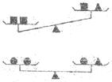

# Mathematics (Grade 6)

**ID**: 2b865431
**难度**: medium_hard
**题型**: multiple_choice

## 题目
设“●”“▲”“■”表示三种不同的物体，现用天平称了两次，情况如图所示，那么●、▲、■这三个物体按质量从大到小的顺序排列为(  )
A．■、●、▲
B．■、▲、●
C．▲、●、■
D．▲、■、●

## 解答

**答案**: A

1. Step1:观察第一次天平称重情况，左边是两个■，右边是一个■和一个▲，因为■+■＞■+▲，两边同时减去一个■，可得■＞▲
2. Step2:观察第二次天平称重情况，左边是两个●，右边是一个●和一个▲，因为●+●＜●+▲，两边同时减去一个●，可得●＜▲
3. Step3:综合Step1和Step2的结果，得出■＞▲且●＜▲，所以三个物体按质量从大到小的顺序排列为■、●、▲，答案选A

## 知识点

**知识点**:
  - 比较大小．

---
