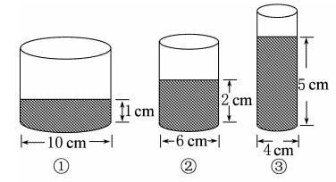

# Mathematics (Grade 6)

**ID**: 2bdd9e10
**难度**: medium_hard
**题型**: multiple_choice

## 题目
下面哪个杯里的水最少？

## 解答

**答案**: ②

1. Step1:根据圆柱体积公式V=πr²h，计算①杯中水的体积，r = 10÷2 = 5cm，h = 1cm，V① = 3.14×5²×1 = 78.5cm³
2. Step2:根据圆柱体积公式V=πr²h，计算②杯中水的体积，r = 6÷2 = 3cm，h = 2cm，V② = 3.14×3²×2 = 56.52cm³
3. Step3:根据圆柱体积公式V=πr²h，计算③杯中水的体积，r = 4÷2 = 2cm，h = 5cm，V③ = 3.14×2²×5 = 62.8cm³
4. Step4:比较三个杯子中水的体积大小，56.52cm³＜62.8cm³＜78.5cm³
5. Step5:得出水最少的杯子是②

## 知识点

**知识点**:
  - 圆柱的体积;小数大小的比较

---
