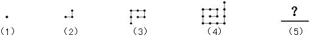

# Mathematics (Grade 6)

**ID**: 2bddc450
**难度**: medium_hard
**题型**: multiple_choice

## 题目
(2013•泉州)按图中的规律接着画下去，第(5)个图形一共有(  )个这样的圆点．

A．20
B．21
C．23
D．26

## 解答

**答案**: B

1. Step1:分析图形规律，发现边的变化为0、2、4、6…，每次增加两条边，每个边上增加1个点
2. Step2:得出对应的点的个数规律为1=1+0×1，2=1+1×2，7=1+2×3，13=1+3×4
3. Step3:总结出第n个图点的个数公式为1+(n - 1)n
4. Step4:当n = 5时，代入公式计算，即1+(5 - 1)×5
5. Step5:先计算括号内5 - 1 = 4
6. Step6:再计算4×5 = 20
7. Step7:最后计算1 + 20 = 21，所以第(5)个图形一共有21个圆点

## 知识点

**知识点**:
  - 数与形结合的规律．

---
