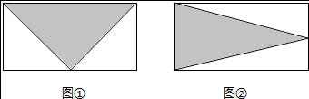

# Mathematics (Grade 6)

**ID**: 2c20c177
**难度**: medium_hard
**题型**: multiple_choice

## 题目
两个完全相同的长方形（如图），将图①和图②阴影部分的面积相比，$\underline{\hspace{5em}}$．

A、图①大    B、图②大    C、图①与图②中的一样大     D、无法比较．

## 解答

**答案**: C

1. Step1:明确已知条件为两个完全相同的长方形
2. Step2:分析图①阴影部分，其为长方形内的三角形，底是长方形的长，高是长方形的宽，根据三角形面积公式可知其面积是长方形面积的一半
3. Step3:分析图②阴影部分，其同样为长方形内的三角形，底是长方形的宽，高是长方形的长，根据三角形面积公式可知其面积是长方形面积的一半
4. Step4:因为两个长方形完全相同，且图①和图②阴影部分面积都为长方形面积的一半，所以图①与图②中阴影部分面积一样大，答案选C

## 知识点

**知识点**:
  - 组合图形的面积．

---
