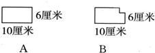

# Mathematics (Grade 6)

**ID**: 2de5206d
**难度**: medium_hard
**题型**: multiple_choice

## 题目
下图中，图A和图B的周长（  ）
A．相等
B．不相等
C．无法确定

## 解答

**答案**: A

1. Step1:观察图形A，可知其为长方形，周长等于长与宽之和的2倍，长为10厘米，宽为6厘米。
2. Step2:观察图形B，发现其右上方的小线段可分别向上、向右平移。
3. Step3:经过平移后，图形B的周长转化为和图形A同样的长方形的周长。
4. Step4:因为图形A和经过平移后图形B的周长都等于长10厘米、宽6厘米的长方形的周长，所以图形A和图形B的周长相等，答案选A。

## 知识点

**知识点**:
  - 长方形的周长；长度比较．

---
