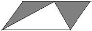

# Mathematics (Grade 6)

**ID**: 2ec98554
**难度**: medium_hard
**题型**: multiple_choice

## 题目
已知平行四边形的面积是20平方厘米，阴影部分的面积是（  ）

$\begin{description}
\item A．15平方厘米\item B．10平方厘米\item C．3.75平方厘米\item D．2.5平方厘米
\end{description}$

## 解答

**答案**: B

1. Step1:明确图中阴影部分的面积是与平行四边形等底等高的三角形的面积
2. Step2:根据等底等高的三角形的面积是平行四边形面积的一半这一性质
3. Step3:已知平行四边形面积为20平方厘米，计算阴影部分面积，即20÷2 = 10平方厘米
4. Step4:对比选项，得出答案为B

## 知识点

**知识点**:
  - 三角形的周长和面积．

---
