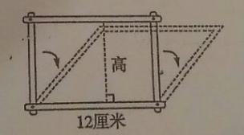

# Mathematics (Grade 6)

**ID**: 2ef38ec5
**难度**: medium_hard
**题型**: multiple_choice

## 题目
用小棒做成一个长方形框架，长12厘米，宽8厘米；如果把它拉成一个平行四解 （如图），拉成的这个平行四边形的面积比原来的长方形面积减少了18平方厘米，那么图中指定的这条高是（  ）。

 12厘米
 A．8厘米
 B．6．5厘米
 C．6厘米
 D．5．5厘米

## 解答

**答案**: C

1. Step1:先计算长方形的面积，根据长方形面积公式 S = 长×宽，可得长方形面积为 12×8 = 96 平方厘米。
2. Step2:因为拉成平行四边形后面积减少了 18 平方厘米，所以平行四边形的面积为 96 - 18 = 78 平方厘米。
3. Step3:已知平行四边形的底为长方形的长 12 厘米，根据平行四边形面积公式 S = 底×高，可得高 = 平行四边形面积÷底，即 78÷12 = 6.5 厘米。

## 知识点

**知识点**:
  - 

---
