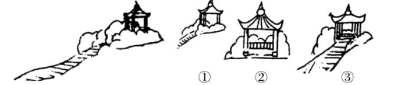

# Mathematics (Grade 6)

**ID**: 2f505d57
**难度**: medium_hard
**题型**: multiple_choice

## 题目
星期天，淘气和爸爸、妈妈一起去爬山，淘气跑在第一，妈妈跑在最后一个。下面三幅图中，图（）是淘气看到的。

A.①
B.②
C.③

## 解答

**答案**: B

1. Step1:明确题目条件，淘气和爸爸、妈妈一起爬山，淘气跑在第一，妈妈跑在最后一个。
2. Step2:根据解题方法提示，距离物体近，看得比较清楚，看的物体也大；反之就看的小。
3. Step3:因为淘气跑在第一，距离亭子最近，所以看到的亭子是最大的。
4. Step4:观察三幅图，图②中的亭子看起来最大，所以图②是淘气看到的，答案选B。

## 知识点

**知识点**:
  - 不同位置观察物体的范围

---
