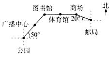

# Mathematics (Grade 6)

**ID**: 304c827e
**难度**: medium_hard
**题型**: multiple_choice

## 题目
以邮局为观测点，商场在（   ）。

$\begin{description}
\item A．北偏西70°方向上\item B．北偏西20°方向上\item C．东偏北20方向上
\end{description}$

## 解答

**答案**: A

1. Step1:明确图上方向规则为上北下南，左西右东
2. Step2:观察图形，以邮局为观测点，确定商场在邮局西偏北20°的方向上
3. Step3:根据方向的另一种表述，计算北偏西角度为90°－20°=70°，即商场在北偏西70°方向上
4. Step4:对比选项，得出答案为A

## 知识点

**知识点**:
  - 

---
