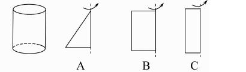

# Mathematics (Grade 6)

**ID**: 310e04b8
**难度**: medium_hard
**题型**: multiple_choice

## 题目
下面的圆柱体是由它右边的图形（）旋转而成的。

## 解答

**答案**: C

1. Step1:明确圆柱的定义，即以矩形一边所在直线为旋转轴，其余三边旋转形成的面所围成的旋转体叫做圆柱
2. Step2:分析选项A，以直角三角形的一条直角边为轴旋转得到的是圆锥，不符合要求
3. Step3:分析选项B和C，以长方形的一边为轴旋转得到的是圆柱
4. Step4:根据所给圆柱底面直径的大小，判断出选项C符合要求

## 知识点

**知识点**:
  - 圆柱的认识;旋转

---
