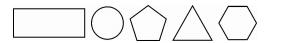

# Mathematics (Grade 6)

**ID**: 3227732a
**难度**: medium_hard
**题型**: multiple_choice

## 题目
如图，图形可以密铺的有（）个。

A.2
B.3
C.4
D.5

## 解答

**答案**: B

1. Step1:明确密铺的定义，即形状、大小完全相同的几种或几十种平面图形进行拼接，彼此之间不留空隙、不重叠地铺成一片
2. Step2:了解能密铺的图形在一个拼接点处的特点，即几个图形的内角拼接在一起时，其和等于360°，并使相等的边互相重合
3. Step3:分析图中图形，圆由于没有边，不满足密铺图形边重合的条件，不能密铺
4. Step4:正五边形每个内角是108°，360°不是108°的整数倍，在拼接点处内角和不能等于360°，不能密铺
5. Step5:长方形的四个角都是直角，四个长方形可以在拼接点处使内角和为360°，能密铺
6. Step6:三角形内角和是180°，两个三角形可以在拼接点处使内角和为360°，能密铺
7. Step7:正六边形每个内角是120°，三个正六边形可以在拼接点处使内角和为360°，能密铺
8. Step8:统计能密铺的图形有长方形、三角形、正六边形，共3个

## 知识点

**知识点**:
  - 密铺

---
