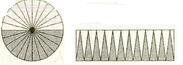

# Mathematics (Grade 6)

**ID**: 3257afbf
**难度**: medium_hard
**题型**: multiple_choice

## 题目
把一个直径是4厘米的圆分成若干等份，然后把它剪开，找图的样子拼起来，拼成的图形的周长比原来圆的周长增加(  )厘米.

## 解答

**答案**: 4

1. Step1:明确圆被拼成近似长方形，根据圆的面积推导过程，可知长方形的长等于圆周长的一半，宽等于圆的半径
2. Step2:分析长方形周长与圆周长的关系，得出长方形的周长比原来圆的周长多出两个半径的长度
3. Step3:因为圆的直径是4厘米，半径为4÷2 = 2厘米，两个半径长度即2×2 = 4厘米，所以拼成的图形的周长比原来圆的周长增加4厘米

## 知识点

**知识点**:
  - 圆的周长

---
