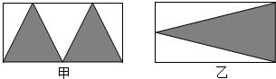

# Mathematics (Grade 6)

**ID**: 32647264
**难度**: medium_hard
**题型**: multiple_choice

## 题目
如图所示，甲、乙两图中的两个大正方形和两个小正方形的边长分别相等，甲和乙两幅图的阴影面积相比，下列说法正确的是（  ）

A．甲＞乙
B．甲＜乙
C．甲=乙
D．不能判断

## 解答

**答案**: C

1. Step1:设小正方形的边长为a，大正方形的边长为2a
2. Step2:计算甲图中阴影部分面积，由两个底和高都为a的三角形组成，根据三角形面积公式S = 底×高÷2，可得甲图阴影面积为a×a÷2×2 = a²
3. Step3:计算乙图中阴影部分面积，底为2a，高为a，根据三角形面积公式可得乙图阴影面积为a×2a÷2 = a²
4. Step4:比较甲、乙两图阴影部分面积，因为甲图阴影面积为a²，乙图阴影面积也为a²，所以甲图中阴影部分的面积等于乙图中阴影部分的面积，答案选C

## 知识点

**知识点**:
  - 组合图形的面积．

---
