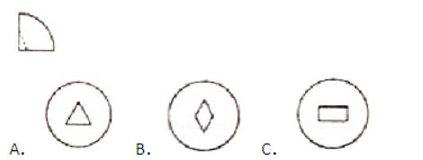

# Mathematics (Grade 6)

**ID**: 33b94339
**难度**: medium_hard
**题型**: multiple_choice

## 题目
把一个圆形纸片对折两次后，得到，然后沿虚线剪开，其中一部分展开后是（）

## 解答

**答案**: B

1. Step1:明确是对圆形纸片对折两次后沿虚线剪开的操作
2. Step2:分析可知剪去的部分是一个四边形，据此可判断选项A不符合，因为A中的图形是三角形
3. Step3:又因为折叠的性质可知该四边形的对角线互相垂直，B选项中的菱形对角线互相垂直，符合条件，C选项中的矩形对角线不一定互相垂直，不符合条件，所以答案是B

## 知识点

**知识点**:
  - 平面图形的切拼(奥数)

---
