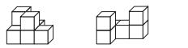

# Mathematics (Grade 6)

**ID**: 347dc01d
**难度**: medium_hard
**题型**: multiple_choice

## 题目
下面两个图从（）观察到的形状相同。

A.左面
B.前面
C.上面

## 解答

**答案**: A

1. Step1:明确本题是观察物体的题目，知道观察方向不同看到的形状不同
2. Step2:根据所给的两个立体图形，分别尝试确定从左面看到的形状
3. Step3:根据所给的两个立体图形，分别尝试确定从前面看到的形状
4. Step4:根据所给的两个立体图形，分别尝试确定从上面看到的形状
5. Step5:分析比较从左面、前面、上面观察两个立体图形所得到的形状，找出形状相同的观察方向
6. Step6:得出从左面观察到的形状相同，答案为A

## 知识点

**知识点**:
  - 从不同位置观察立体图形

---
