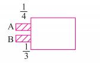

# Mathematics (Grade 6)

**ID**: 35a90ad1
**难度**: medium_hard
**题型**: multiple_choice

## 题目
如图，用纸板盖住A，B两根木条的一端，根据露出的部分推断，两根木条相比，（）。

A.A根长
B.B根长
C.无法确定

## 解答

**答案**: A

1. Step1:根据图中信息，得出A木条的$rac{1}{4}$与B木条的$rac{1}{3}$长度相等
2. Step2:假设A木条的$rac{1}{4}$与B木条的$rac{1}{3}$都等于1
3. Step3:根据分数的意义，计算A木条的长度为1÷$rac{1}{4}$=4
4. Step4:根据分数的意义，计算B木条的长度为1÷$rac{1}{3}$=3
5. Step5:比较A、B木条的长度，4＞3，所以A木条较长，答案选A

## 知识点

**知识点**:
  - 分数除法应用题

---
