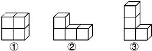

# Mathematics (Grade 6)

**ID**: 36036b17
**难度**: medium_hard
**题型**: multiple_choice

## 题目
从上面看下面3个物体，哪两个物体看到的形状是相同的？（  ）
A．①和②
B．②和③
C．①和③

## 解答

**答案**: C

1. Step1:确定图形①从上面看到的图形是一行2个正方形
2. Step2:确定图形②从上面看到的图形是一行3个正方形
3. Step3:确定图形③从上面看到的图形是一行2个正方形
4. Step4:对比发现图形①和③从上面看到的图形相同
5. Step5:得出答案为C

## 知识点

**知识点**:
  - 从不同方向观察物体和几何体．

---
