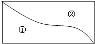

# Mathematics (Grade 6)

**ID**: 36b7961c
**难度**: medium_hard
**题型**: multiple_choice

## 题目
在图中，①②两部分的周长比较（  ）
$\begin{description}
\item A．①的大工\item B．②的大\item C．相等
\end{description}$

## 解答

**答案**: C

1. Step1:明确图形①的周长组成，为长方形周长的一半与中间曲折线的长度之和
2. Step2:明确图形②的周长组成，为长方形周长的一半与中间曲折线的长度之和
3. Step3:对比图形①和图形②的周长组成，发现二者相同，所以得出它们的周长相等，答案选C

## 知识点

**知识点**:
  - 长度比较．

---
