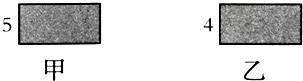

# Mathematics (Grade 6)

**ID**: 377dd310
**难度**: medium_hard
**题型**: multiple_choice

## 题目
两个多位数被两个纸板挡住了，只露出最高位上的数字（如图）．两数比较（  ）

$\begin{description}
\item A．甲数大\item B．乙数大\item C．无法确定
\end{description}$

## 解答

**答案**: C

1. Step1:明确题目条件，仅知道两个多位数露出的最高位数字分别为5和4，未提及两数的位数情况
2. Step2:考虑两数位数的不同可能性，可能位数相同，也可能不同
3. Step3:因为不知道两数的位数情况，所以仅依据最高位数字5和4，无法确定两数的大小关系
4. Step4:得出结论，无法确定甲数和乙数谁大，答案选C

## 知识点

**知识点**:
  - 整数大小的比较．

---
