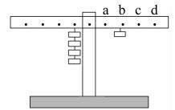

# Mathematics (Grade 6)

**ID**: 39b7c08c
**难度**: medium_hard
**题型**: multiple_choice

## 题目
科学课上同学们做“平衡架”实验（如图，使用的钩码质量都相同），张老师在平衡架的两边挂了一些钩码，要使平衡架平衡，a处应挂（）个钩码。

## 解答

**答案**: 2

1. Step1:根据杠杆原理，明确要使平衡架平衡，两边钩码重量与它们离支点的距离相乘的积需相等
2. Step2:观察图，确定左边有4个钩码，离支点1格，计算左边的乘积为4×1
3. Step3:观察图，确定a处离支点1格，b处离支点2格，设a处放x个钩码，计算右边的式子为2×1+x
4. Step4:根据平衡条件列出等式4×1=2×1+x
5. Step5:对等式4=2+x进行计算，得出x=2，即a处应挂2个钩码

## 知识点

**知识点**:
  - 正、反比例应用题

---
