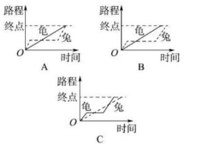

# Mathematics (Grade 6)

**ID**: 3a5e24a6
**难度**: medium_hard
**题型**: multiple_choice

## 题目
龟兔赛跑的故事，领先的兔子骄傲起来，睡了一觉．当它醒来时，发现乌龟快到终点了，于是急忙追赶，但是为时已晚，乌龟还是先到了终点…下列的折线图中与故事情节相吻合的是（）

## 解答

**答案**: B

1. Step1:分析图A，开始兔子领先，休息后乌龟领先，最后龟和兔同时到达终点
2. Step2:分析图B，开始兔子领先，休息时乌龟持续前进，兔子醒来追赶但乌龟先到终点
3. Step3:分析图C，开始兔子领先，休息时乌龟前进，最后兔子比乌龟先到终点
4. Step4:根据故事情节，乌龟先到终点，对比发现图B与之相吻合
5. Step5:得出答案为B

## 知识点

**知识点**:
  - 复式折线统计图

---
