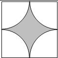

# Mathematics (Grade 6)

**ID**: 3a9f078c
**难度**: medium_hard
**题型**: multiple_choice

## 题目
如图所示，正方形的边长6厘米，计算阴影部分的面积，方法正确的是（  ）

A．6×6-3.14×3×3
B．6×6-3.14×6×6÷2
C．3.14×3×3×2
D．3×3×3.14÷4

## 解答

**答案**: A

1. Step1:明确阴影部分面积的计算方法为阴影部分的面积=正方形的面积-圆的面积
2. Step2:根据正方形边长为6厘米，可得正方形面积为6×6
3. Step3:因为圆的半径是正方形边长的一半，即6÷2 = 3厘米
4. Step4:根据圆的面积公式S = πr²，这里π取3.14，半径r = 3厘米，所以圆的面积为3.14×3×3
5. Step5:所以阴影部分面积为6×6 - 3.14×3×3，答案选A

## 知识点

**知识点**:
  - 组合图形的面积．

---
