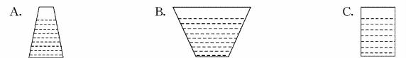

# Mathematics (Grade 6)

**ID**: 3c8cee01
**难度**: medium_hard
**题型**: multiple_choice

## 题目
下面各容器中盛水的高度相同，分别把a克盐（a＞0）全部溶解在下面各容器的水中，（）的含盐率最高。

## 解答

**答案**: A

1. Step1:明确含盐率的计算方法，含盐率是盐占盐水的百分比，即含盐率 = 盐的质量÷盐水的质量×100%，盐水质量 = 盐的质量 + 水的质量
2. Step2:已知三个容器中放入盐的质量都为a克（a＞0），那么在盐质量相同的情况下，水的质量越少，盐水的质量就越少
3. Step3:因为水面高度相同，观察三个容器的形状可知A容器里面的水最少
4. Step4:根据含盐率的计算方法和前面的推理，水越少则盐水越少，在盐质量相同的情况下，盐水越少含盐率越高，所以A容器的含盐率最高

## 知识点

**知识点**:
  - 百分数的认识

---
