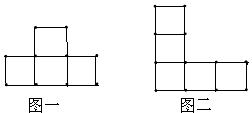

# Mathematics (Grade 6)

**ID**: 3d70f979
**难度**: medium_hard
**题型**: multiple_choice

## 题目
如图两个图形的周长______
A．图一短   B．图二长   C．图一长   D．图二短   E．图一和图二一样长．

## 解答

**答案**: B

1. Step1:设每个小正方形的边长为1
2. Step2:计算图形一的周长，通过数围成图形一的小正方形边长的数量，可得其周长为10
3. Step3:计算图形二的周长，通过数围成图形二的小正方形边长的数量，可得其周长为12
4. Step4:比较两个图形的周长大小，10<12，所以图二的周长更长
5. Step5:根据选项，选择答案B

## 知识点

**知识点**:
  - 长方形的周长．

---
