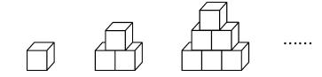

# Mathematics (Grade 6)

**ID**: 3e6b1839
**难度**: medium_hard
**题型**: multiple_choice

## 题目
如图，依这种规律堆放方块，第10堆应有方块（）。

A.50个
B.60个
C.65个
D.55个

## 解答

**答案**: D

1. Step1:观察图形，发现规律，可知第n堆有n行，第1行有1个小正方体，第2行有2个小正方体，以此类推，第n行有n个小正方体
2. Step2:当n = 10时，第10堆有10行，分别有1、2、3、...、10个小正方体
3. Step3:计算第10堆小正方体的总数，即1+2+3+…+10
4. Step4:根据等差数列求和公式S = (首项 + 末项)×项数÷2，这里首项为1，末项为10，项数为10，可得(1 + 10)×10÷2 = 55个
5. Step5:对比选项，得出答案为D

## 知识点

**知识点**:
  - 图形中的规律

---
