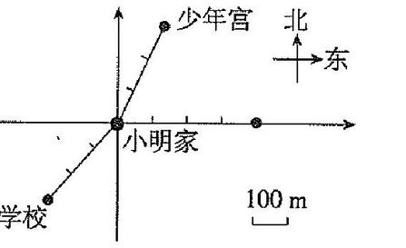

# Mathematics (Grade 6)

**ID**: 3f450b2c
**难度**: medium_hard
**题型**: multiple_choice

## 题目
小明从家出发步行去学校，下面说法正确的是（  ）

 少年宫  小明家   学校 100m
 A．向东南方向行走400m
 B．向西南方向行走300m
 C．向东北方向行走300m

## 解答

**答案**: B

1. Step1:根据题中文字确定方向规则为上北下南，左西右东
2. Step2:观察图可知学校在小明家的西南方向
3. Step3:根据图中比例尺，1格代表100m，数出小明家到学校的图上距离是3格，所以实际距离为3×100 = 300m
4. Step4:综合方向和距离，可知小明从家去学校是向西南方向行走300m，所以答案选B

## 知识点

**知识点**:
  - 期末测试卷;

---
