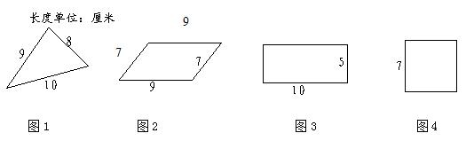

# Mathematics (Grade 6)

**ID**: 3fc13471
**难度**: medium_hard
**题型**: multiple_choice

## 题目
下面三张图，周长最长的是 $\underline{\hspace{5em}}$  ，最短的是 $\underline{\hspace{5em}}$ 。正确选项是（ ）

A．图2；图1
B．图3；图2
C．图3；图4
D．图2；图4；

## 解答

**答案**: A

1. Step1:计算图1的周长，根据三角形周长等于三边之和，可得图1周长为9 + 8 + 10 = 27厘米
2. Step2:计算图2的周长，平行四边形周长为相邻两边之和的2倍，即(9 + 7)×2 = 32厘米
3. Step3:计算图3的周长，长方形周长为(长 + 宽)×2，即(10 + 5)×2 = 30厘米
4. Step4:计算图4的周长，正方形周长为边长×4，即7×4 = 28厘米
5. Step5:比较周长大小，32＞30＞28＞27，所以周长最长的是图2，最短的是图1

## 知识点

**知识点**:
  - 小学数学;图形与几何;平面图形;长方形和正方形;长方形的周长;正方形的周长;梯形的特征及分类;梯形的周长;三角形;三角形的周长

---
