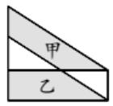

# Mathematics (Grade 6)

**ID**: 40546f14
**难度**: medium_hard
**题型**: multiple_choice

## 题目
下图中，涂色部分的面积相比，甲（）乙。

A.＞
B.＜
C.=

## 解答

**答案**: C

1. Step1:观察图形可知，甲阴影梯形加上甲左下方空白三角形组成一个新三角形，乙阴影梯形加上甲左下方空白三角形也组成一个新三角形
2. Step2:发现这两个新三角形等底等高，根据三角形面积公式，等底等高的三角形面积相等，所以这两个新三角形面积相等
3. Step3:因为两个新三角形都包含甲左下方空白三角形这一公共部分，都减去公共部分空白三角形的面积，那么剩下的甲、乙的面积相等
4. Step4:所以甲和乙面积相比是相等的，答案选C

## 知识点

**知识点**:
  - 梯形的面积;三角形的面积

---
