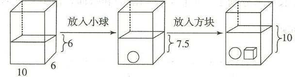

# Mathematics (Grade 6)

**ID**: 415ea4a9
**难度**: medium_hard
**题型**: multiple_choice

## 题目
5．如图，在一个长方体水槽中，水面高为6，放入小球后水面高为7.5，再放入一个正方体后，水面高为10，正方体体积与球相比(    ).
   A．球的体积大
   B．正方体体积大
   C．无法比较
   D．同样大

## 解答

**答案**: B

1. Step1:计算放入小球后水面上升的高度，7.5 - 6 = 1.5
2. Step2:计算放入正方体后水面上升的高度，10 - 7.5 = 2.5
3. Step3:比较两次水面上升的高度，2.5 > 1.5
4. Step4:因为长方体水槽长和宽一定，根据水面上升高度越大对应物体体积越大，得出正方体体积大于球的体积，所以答案选B

## 知识点

**知识点**:
  - 第三单元测试卷
--

---
