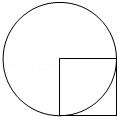

# Mathematics (Grade 6)

**ID**: 4176ee2f
**难度**: medium_hard
**题型**: multiple_choice

## 题目
如图，已知小正方形面积是10平方厘米，圆的面积是（  ）平方厘米．

A．40
B．62.8
C．314
D．31.4

## 解答

**答案**: D

1. Step1:观察图形可知，小正方形的边长等于圆的半径r
2. Step2:根据正方形面积公式S=a²（a为边长），已知小正方形面积是10平方厘米，所以r² = 10
3. Step3:根据圆的面积公式S=πr²，π取3.14，将r² = 10代入，可得S = 3.14×10
4. Step4:计算3.14×10 = 31.4平方厘米，所以圆的面积是31.4平方厘米，答案选D

## 知识点

**知识点**:
  - 

---
