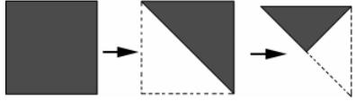

# Mathematics (Grade 6)

**ID**: 41b5a319
**难度**: medium_hard
**题型**: multiple_choice

## 题目
下列说法正确的是（）。

A.第一幅图中的直角比其他两幅图中的直角都大
B.第三幅图中的直角比其他两幅图的直角都小
C.三幅图中的直角一样大

## 解答

**答案**: C

1. Step1:明确本题考查直角的认识，关键在于掌握直角的特征。
2. Step2:依据直角的定义，所有的直角度数都是90°。
3. Step3:判断三幅图中的角均为直角，所以三幅图中的直角一样大。
4. Step4:得出答案为C。

## 知识点

**知识点**:
  - 角的认识

---
