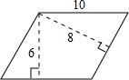

# Mathematics (Grade 6)

**ID**: 41c51d54
**难度**: medium_hard
**题型**: multiple_choice

## 题目
图中平行四边形的面积是（  ）平方厘米（单位：厘米）．
$\begin{description}
\item A．80\item B．60\item C．48
\end{description}$

## 解答

**答案**: B

1. Step1:明确平行四边形面积公式为底×高
2. Step2:观察图形可知底为10厘米，对应的高为6厘米
3. Step3:根据面积公式计算面积，即10×6 = 60平方厘米
4. Step4:对比选项，得出答案为B

## 知识点

**知识点**:
  - 平行四边形的面积．

---
