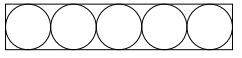

# Mathematics (Grade 6)

**ID**: 426ca180
**难度**: medium_hard
**题型**: multiple_choice

## 题目
如图，盒子内刚好放下五个圆柱形罐头瓶，每个圆柱形罐头瓶的横截面的面积为28.26cm$^{2}$，这个盒子的长为（）。

A.15cm
B.30cm
C.25cm

## 解答

**答案**: B

1. Step1:根据圆的面积公式圆的面积=π×半径²，已知每个圆柱形罐头瓶横截面面积为28.26cm²，π取3.14，计算28.26÷3.14=9（平方厘米），得到半径的平方为9平方厘米
2. Step2:因为3×3=9，所以得出圆的半径是3厘米
3. Step3:观察图形可知盒子的长相当于5个圆的直径，而圆的直径是半径的2倍，所以盒子的长相当于10个半径的长
4. Step4:已知半径为3厘米，计算3×10=30（厘米），得出盒子的长为30厘米，故答案选B

## 知识点

**知识点**:
  - 圆的面积

---
