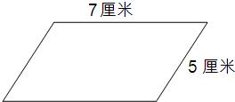

# Mathematics (Grade 6)

**ID**: 44674e6b
**难度**: medium_hard
**题型**: multiple_choice

## 题目
如图，这个平行四边形的高是6厘米，它的面积是$\underline{\hspace{5em}}$．
①42平方厘米 ②35平方厘米 ③30平方厘米 ④无法确定．

## 解答

**答案**: ③

1. Step1:观察平行四边形的两条边长度分别为7厘米和5厘米
2. Step2:比较边的长度与高的大小，7＞6，5＜6
3. Step3:根据两平行线之间的距离只能比一组底边小，得出高6厘米对应的底是5厘米
4. Step4:根据平行四边形面积公式底×高，计算面积为6×5 = 30平方厘米
5. Step5:得出答案为③

## 知识点

**知识点**:
  - 平行四边形的面积．

---
