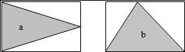

# Mathematics (Grade 6)

**ID**: 453500d4
**难度**: medium_hard
**题型**: multiple_choice

## 题目
在两个完全相同的长方形中，阴影部分面积（  ）

A．a＞b
B．a=b
C．a＜b

## 解答

**答案**: B

1. Step1:明确两个三角形a和b分别在两个完全相同的长方形中
2. Step2:观察发现a三角形与b三角形的底和高分别等于长方形的长和宽
3. Step3:根据三角形面积公式：三角形的面积=底×高÷2，可知a三角形面积为长方形长×长方形宽÷2，b三角形面积也为长方形长×长方形宽÷2
4. Step4:得出a三角形与b三角形面积相等的结论，所以答案选B

## 知识点

**知识点**:
  - 面积及面积的大小比较．

---
