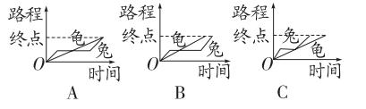

# Mathematics (Grade 6)

**ID**: 472f1bb3
**难度**: medium_hard
**题型**: multiple_choice

## 题目
“龟兔赛跑”的故事：领先的兔子骄傲起来，睡了一觉。 当它醒来时，发现乌龟快到终点了，于是急忙追赶，但是为时已晚，乌龟还是先到了终点…下列折线图中与故事情节相吻合的是（）

## 解答

**答案**: B

1. Step1:明确故事内容为兔子先领先，然后睡觉，醒来后追赶，乌龟先到终点
2. Step2:分析图A，其表示龟和兔同时到达终点，不符合故事内容
3. Step3:分析图B，其表示龟比兔早到达终点，符合故事中乌龟先到终点的情节
4. Step4:分析图C，其表示兔比龟早到达终点，不符合故事内容
5. Step5:综上，与故事情节相吻合的是图B，答案为B

## 知识点

**知识点**:
  - 复式折线统计图

---
