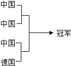

# Mathematics (Grade 6)

**ID**: 479e3d05
**难度**: medium_hard
**题型**: multiple_choice

## 题目
某届世界杯乒乓球赛，有3名中国队员和1名德国队员进入男单四分之一决赛，比赛规定如下图所示．下面预测结果不正确的是（  ）
$\begin{description}
\item A．中国队稳获亚军\item B．德国队可能会夺得冠军\item C．中国队夺得冠军的可能性是\frac{1}{4}
\end{description}$

## 解答

**答案**: C

1. Step1:分析选项A，由于有4人参赛，中国队3人，德国队1人，即便德国队赢，中国队也必定能获得亚军，所以A说法正确
2. Step2:分析选项B，因为德国队有1名队员参赛，所以存在获得冠军的可能性，B说法正确
3. Step3:分析选项C，比赛要决出冠军需进行多场比赛，而中国队有3人参赛，夺得冠军的可能性不是1/4，C说法错误
4. Step4:综合以上分析，预测结果不正确的是C

## 知识点

**知识点**:
  - 事件的确定性与不确定性．

---
