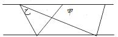

# Mathematics (Grade 6)

**ID**: 47d642f3
**难度**: medium_hard
**题型**: multiple_choice

## 题目
如图，甲的面积是乙的面积的(  )

A．1倍
B．2倍
C．3倍
D．不确定

## 解答

**答案**: B

1. Step1:明确三角形面积公式为三角形的面积=底×高÷2
2. Step2:观察图形可知图形甲和图形乙都是三角形且高相等
3. Step3:发现图形甲的底是图形乙的2倍
4. Step4:根据三角形面积公式以及甲、乙高相等且甲底是乙底2倍，得出甲的面积是乙面积的2倍
5. Step5:根据得出的倍数关系，在选项中选择B

## 知识点

**知识点**:
  - 面积及面积的大小比较．

---
