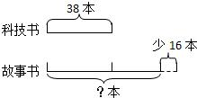

# Mathematics (Grade 6)

**ID**: 48df8a0d
**难度**: medium_hard
**题型**: multiple_choice

## 题目
根据线段图，如图错误的算式是（  ）

$\begin{description}
\item A．38×2-16\item B．38-16+38\item C．38×3-16
\end{description}$

## 解答

**答案**: C

1. Step1:由线段图可知科技书有38本，故事书比科技书的2倍少16本
2. Step2:根据求一个数的倍数用乘法，比一个数少用减法，可得到故事书数量的算式为38×2 - 16
3. Step3:38×2 - 16也可写成38 + 38 - 16
4. Step4:对比选项，38×3 - 16这个算式不符合故事书与科技书数量关系，所以C选项错误

## 知识点

**知识点**:
  - 图文应用题．

---
