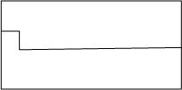

# Mathematics (Grade 6)

**ID**: 4ae32bce
**难度**: medium_hard
**题型**: multiple_choice

## 题目
如图8长方形分成两部分，想一想，哪个部分8周长长．（  ）

$\begin{description}
\item A．上面的\item B．下面的\item C．一样长
\end{description}$

## 解答

**答案**: B

1. Step1:观察图形，明确长方形对边长度相等，即上下两条边长度相等，折线是上下两部分的公共边
2. Step2:设上面部分除公共边和上下边外的两条边分别为c和d，下面部分除公共边和上下边外的两条边分别为a和b，且a＞c，b＞d
3. Step3:计算上面部分的周长为上下边长度和加上c、d的长度以及公共边长度
4. Step4:计算下面部分的周长为上下边长度和加上a、b的长度以及公共边长度
5. Step5:比较上下两部分周长，因为a＞c，b＞d，其他部分相同，所以下面部分的周长大于上面部分的周长
6. Step6:得出答案为B

## 知识点

**知识点**:
  - 长方形的周长．

---
