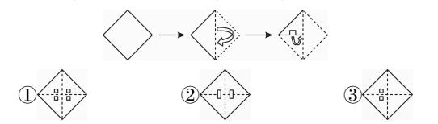

# Mathematics (Grade 6)

**ID**: 4b76c1e3
**难度**: medium_hard
**题型**: multiple_choice

## 题目
手工课上，昊然将一张正方形纸片按下图所示，对折两次，并在下图所示位置上剪去一个小正方形，然后把纸片展开，得到的图形应是（）。

## 解答

**答案**: ②

1. Step1:准备一张正方形纸片
2. Step2:将正方形纸片按照给定方式对折两次
3. Step3:在指定位置剪去一个小正方形
4. Step4:展开纸片观察得到的图形
5. Step5:将得到的图形与选项对比，发现是②

## 知识点

**知识点**:
  - 

---
