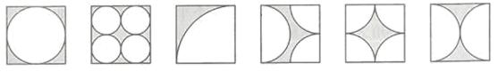

# Mathematics (Grade 6)

**ID**: 4c597c73
**难度**: medium_hard
**题型**: multiple_choice

## 题目
下面图形中阴影部分的面积与左边第一个图阴影部分面积相等的有（   ）个。

A．2
B．3
C．4
D．5

## 解答

**答案**: D

1. Step1:分析左边第一个图，得出其阴影部分面积等于正方形面积减去空白圆的面积
2. Step2:观察后面几个图形，发现它们的空白部分都能转化成与左边第一个图大空白圆相等的面积
3. Step3:根据上述发现，推断出后面几个图形阴影部分面积都与左边第一个图相等
4. Step4:统计与左边第一个图阴影部分面积相等的图形个数为5个

## 知识点

**知识点**:
  - 

---
