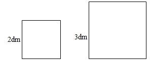

# Mathematics (Grade 6)

**ID**: 4c77a147
**难度**: medium_hard
**题型**: multiple_choice

## 题目
(2012•龙岗区)李老师准备给健身房铺正方形地砖，如果选择边长为3dm的地砖要400块．那么选择边长为2dm的地砖要(  )块．

A．600
B．900
C．1200
D．1800

## 解答

**答案**: B

1. Step1:根据题意可知，健身房的面积是固定的，由于方砖的面积和方砖的块数成反比例关系，所以可据此列方程求解
2. Step2:设选择边长为2dm的地砖要x块，边长为2dm的地砖面积为2×2 = 4(dm²)，边长为3dm的地砖面积为3×3 = 9(dm²)，边长为3dm的地砖要400块，则可列出方程2×2×x = 3×3×400
3. Step3:化简方程2×2×x = 3×3×400，得到4x = 3600
4. Step4:求解方程4x = 3600，两边同时除以4，得出x = 900，即选择边长2dm的地砖要900块，所以答案选B

## 知识点

**知识点**:
  - 正、反比例应用题．

---
