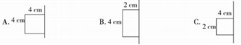

# Mathematics (Grade 6)

**ID**: 4d416a08
**难度**: medium_hard
**题型**: multiple_choice

## 题目
如图所示， 将下面的纸板以一条边为轴旋转一周，能够形成底面积直径和高是4cm的圆柱是（）

## 解答

**答案**: B

1. Step1:根据圆柱底面积直径和高是4cm，计算底面半径为4÷2 = 2cm
2. Step2:分析选项A，以一条边为轴旋转一周形成的圆柱底面半径和高均为4cm，不符合要求
3. Step3:分析选项B，以2cm的边为轴旋转一周，形成的圆柱底面半径是4cm，高是2cm，以4cm的边为轴旋转一周，形成的圆柱底面半径是2cm，高是4cm，符合要求
4. Step4:分析选项C，以一条边为轴旋转一周形成的圆柱底面半径和高与题目要求不符
5. Step5:综上，能够形成底面积直径和高是4cm的圆柱是B

## 知识点

**知识点**:
  - 圆柱的认识

---
