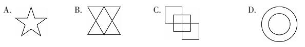

# Mathematics (Grade 6)

**ID**: 4de9ae02
**难度**: medium_hard
**题型**: multiple_choice

## 题目
下列图案中，对称轴条数最多的是（）。

## 解答

**答案**: D

1. Step1:根据轴对称图形定义，分析选项A的图形，得出其有5条对称轴
2. Step2:根据轴对称图形定义，分析选项B的图形，得出其有2条对称轴
3. Step3:根据轴对称图形定义，分析选项C的图形，得出其有2条对称轴
4. Step4:根据轴对称图形定义，分析选项D的图形，得出其有无数条对称轴
5. Step5:比较各选项对称轴数量，5＞2，无数条大于5条和2条，所以选项D图形对称轴条数最多，答案为D

## 知识点

**知识点**:
  - 轴对称图形的定义

---
