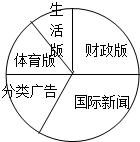

# Mathematics (Grade 6)

**ID**: 4eb84ef4
**难度**: medium_hard
**题型**: multiple_choice

## 题目
有一份《华盛顿日报》，此报纸共206页，看图估计：体育版约占多少页？（  ）

A．10
B．30
C．50
D．100

## 解答

**答案**: B

1. Step1:找出体育版与生活版的和所对应的圆心角的度数为90°
2. Step2:计算体育版与生活版的和占总体的百分比，即90°÷360°×100%=25%
3. Step3:根据图估计体育版大约占体育版和生活版和的60%
4. Step4:计算体育版占总体的百分比，即60%×25%=15%
5. Step5:计算体育版的页数，206×15%≈30页

## 知识点

**知识点**:
  - 扇形统计图．

---
