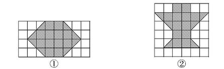

# Mathematics (Grade 6)

**ID**: 4f549a42
**难度**: medium_hard
**题型**: multiple_choice

## 题目
图①中阴影的面积（）图②中阴影的面积。

A.＞
B.＜
C.=

## 解答

**答案**: A

1. Step1:将一个小正方形的面积看作1，数图①中整格的个数，得到有12个整格
2. Step2:数图①中半格的个数，得到有8个半格
3. Step3:计算图①阴影面积，根据公式可得12 + 8÷2 = 16
4. Step4:数图②中整格的个数，得到有12个整格
5. Step5:数图②中半格的个数，得到有6个半格
6. Step6:计算图②阴影面积，根据公式可得12 + 6÷2 = 15
7. Step7:比较图①和图②阴影面积大小，因为16＞15，所以图①中阴影的面积＞图②中阴影的面积，答案选A

## 知识点

**知识点**:
  - 面积单位的认识、进率及换算

---
