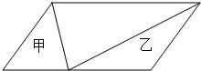

# Mathematics (Grade 6)

**ID**: 50130844
**难度**: medium_hard
**题型**: multiple_choice

## 题目
如图，甲三角形的面积占平行四边形面积的18%，乙三角形面积是64平方厘米，则平行四边形面积是(  )
A．100
B．192
C．200
D．256

## 解答

**答案**: C

1. Step1:把平行四边形的面积看作单位'1'，因为甲和乙的面积之和占平行四边形面积的$rac{1}{2}$，且甲三角形的面积占平行四边形面积的18%，所以乙三角形面积占平行四边形面积的比例为$rac{1}{2}-18\%$
2. Step2:将$rac{1}{2}$转化为百分数为50%，则$rac{1}{2}-18\%=50\%-18\%=32\%$，即乙三角形面积占平行四边形面积的32%
3. Step3:已知乙三角形面积是64平方厘米，且乙三角形面积占平行四边形面积的32%，根据已知一个数的百分之几是多少，求这个数用除法，所以平行四边形面积为64÷32%
4. Step4:计算64÷32%，32%可化为0.32，64÷0.32 = 200平方厘米，所以平行四边形面积是200平方厘米，答案选C

## 知识点

**知识点**:
  - 平行四边形的面积;分数除法应用题．

---
