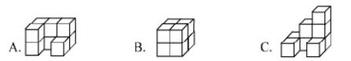

# Mathematics (Grade 6)

**ID**: 501f8a3c
**难度**: medium_hard
**题型**: multiple_choice

## 题目
下面第（）堆物体的小正方体的个数与其他两堆不相等。

## 解答

**答案**: A

1. Step1:按照一定顺序数A堆小正方体个数，得出有9个
2. Step2:按照一定顺序数B堆小正方体个数，得出有8个
3. Step3:按照一定顺序数C堆小正方体个数，得出有8个
4. Step4:对比三堆小正方体个数，发现A堆个数与B、C堆不同

## 知识点

**知识点**:
  - 立体图形的识别

---
