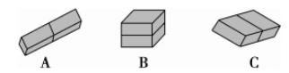

# Mathematics (Grade 6)

**ID**: 51711110
**难度**: medium_hard
**题型**: multiple_choice

## 题目
把两个长8厘米、宽5厘米、高3厘米的长方体包装在一起，最省纸的是（）。

## 解答

**答案**: B

1. Step1:明确最省纸即组合后长方体表面积最小
2. Step2:分析A选项，组合后长方体长为8×2 = 16厘米，宽5厘米，高3厘米，根据长方体表面积公式(长×宽+长×高+宽×高)×2，可得其表面积为(16×5+16×3+5×3)×2=286平方厘米
3. Step3:分析B选项，组合后长方体长8厘米，宽5厘米，高3×2 = 6厘米，根据公式可得其表面积为(8×5+8×6+5×6)×2=236平方厘米
4. Step4:分析C选项，组合后长方体长8厘米，宽5×2 = 10厘米，高3厘米，根据公式可得其表面积为(8×10+8×3+10×3)×2=268平方厘米
5. Step5:比较三个选项的表面积大小，236＜268＜286，得出表面积最小的是B，所以最省纸的是B

## 知识点

**知识点**:
  - 长方体和正方体的表面积;整数大小的比较

---
